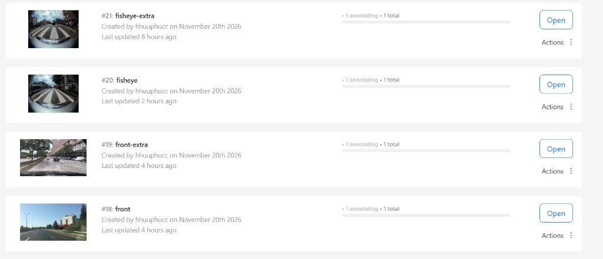
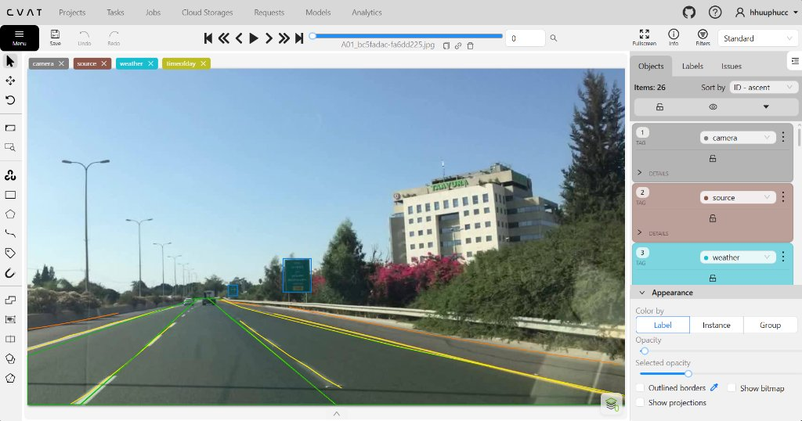
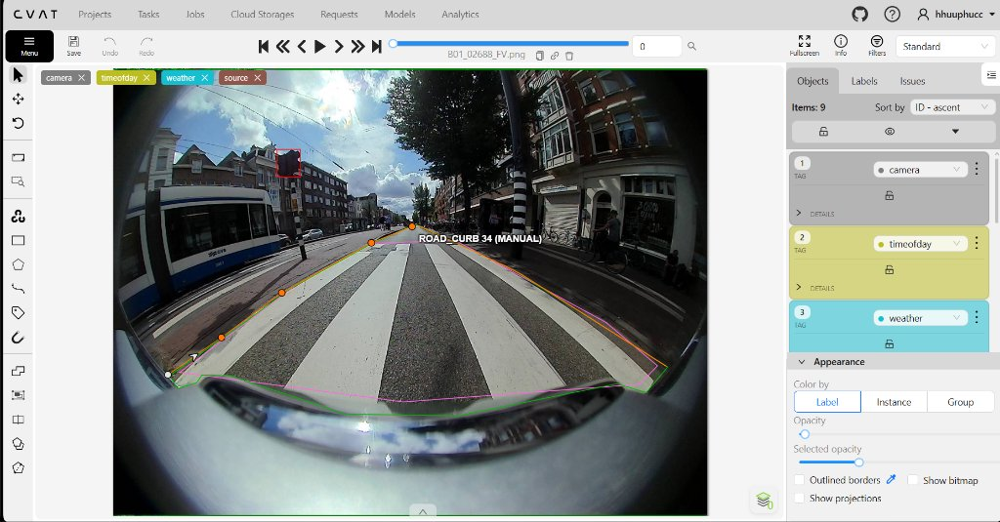

# Báo cáo cá nhân — Ngày 11
Họ tên: Trần Nguyễn Hữu Phúc               Mã học viên: `2A202603303`  
Phiên bản CVAT (Help → About): `CVAT v2.74.1` (Docker local)  
Guideline: `Road v1.0`    Lần nộp (`revision` trong manifest): `1`  
Thời điểm export (ngày giờ trên CVAT): `2026-11-20 22:19 (UTC+7)` (`2026-11-20T15:19:02+00:00` trong manifest)    Số lần nộp lại sau Rework: `0`

## 1. Kiểm project
| Mục | Đúng như guideline Road v1.0? | Ghi chú |
| --- | --- | --- |
| 6 label, đúng kiểu | Đúng | `lane` (polyline), `road_curb` (polyline), `crosswalk` (polygon), `drivable` (polygon), `traffic_light` (rectangle), `traffic_sign` (rectangle) — khớp `configs/road_v1_labels.json`. |
| Thuộc tính và giá trị | Đúng | Đủ các thuộc tính `select` và `checkbox` (`edge_zone`) đúng tên và tập giá trị của `Road v1.0`. |
| 4 tag ảnh | Đúng | `camera`, `timeofday`, `weather`, `source` đều là label kiểu `tag` với thuộc tính `value`. |

Cách kết thúc polyline trên bản CVAT này: Nhấn phím `N` (hoặc nhấp đúp điểm cuối / bấm `Done`).  
Cách đặt tag ảnh trên bản CVAT này: Dùng công cụ `Tag` trên thanh bên trái để thêm đủ 4 tag (`camera` đặt đầu tiên), sau đó mở `Details` trong bảng `Objects` để chỉnh `value` cho từng tag (vì CVAT tự điền giá trị đầu danh sách như `weather=clear`).

## 2. Số lượng đã gán
| Task | Ảnh | lane | road_curb | crosswalk | drivable | traffic_light | traffic_sign |
| --- | ---: | ---: | ---: | ---: | ---: | ---: | ---: |
| front | 12 | 27 | 20 | 5 | 30 | 21 | 17 |
| front-extra (đã làm 0 / 4) | 0 | 0 | 0 | 0 | 0 | 0 | 0 |
| fisheye | 8 | 4 | 12 | 7 | 11 | 4 | 2 |
| fisheye-extra (đã làm 0 / 4) | 0 | 0 | 0 | 0 | 0 | 0 | 0 |

## 3. Bảng ca khó
| Ảnh | Nhãn | Phân vân giữa | Đã chọn | Lý do |
| --- | --- | --- | --- | --- |
| A06_b8c66e31-37045eec.jpg | `lane#10` (`L1`) | `style=solid` vs `dashed` | `style=dashed`, `color=yellow`, `kind=double` | Vạch tim đường là vạch đôi một liền một đứt (QCVN 1.4), guideline không có giá trị riêng nên chọn nửa nét đứt phía sát làn đang đi và dừng trước đoạn bị hàng xe đối diện che khuất kéo dài. |
| A05, A06, A07, A08, A09 | `lane` (`L1`/`R1`) | Vẽ suy đoán vs không vẽ | Không vẽ vạch không tồn tại | Các vị trí này thực tế mặt đường không sơn vạch (`A05` đường không vạch; `A06`, `A09` không có `R1`; `A07`, `A08` không có `L1`). Theo guideline không vẽ vạch không thấy được và chấp nhận 6 cảnh báo `QC1-02` của `lint` để coach xác nhận miễn trừ. |
| A06, A12, B02 | `traffic_light` (`pedestrian`) | `color=unknown` vs `green` | `color=green`, `type=pedestrian` | Đèn người đi bộ hiển thị hình người màu trắng/xanh sáng cho phép qua đường; taxonomy `Road v1.0` chỉ có `red/yellow/green/off/unknown`, không có `white`, nên quy ước về `green`. |
| B04_05535_RV.png | `traffic_sign#1` & `traffic_light#7` | `prohibitory` vs `information`; `edge_zone` | `group=prohibitory` (`edge_zone=true`); đèn dưới `edge_zone=false` | Biển vuông xanh-trắng có gạch chéo đỏ (biển châu Âu báo hết đoạn ưu tiên/cấm đỗ) nằm ngoài 80% bán kính (`edge_zone=true`), còn đèn mũi tên đỏ ngay dưới có tâm nằm trong 80% bán kính (`edge_zone=false`). |

## 4. Phiếu QC 1 nhận được
Bạn kiểm lô của tôi: Chưa nhận Phiếu QC 1 từ bạn kiểm (đây là bản nộp lần đầu `revision=1`)  Quyết định nhận được: Đang chờ kiểm chéo (đã tự rà & sửa lỗi trước khi nộp)  
| Mã lỗi | Số lỗi | Đồng ý? | Đã sửa? |
| --- | ---: | --- | --- |
| QC1-01 | 0 (tự rà `weather`/`timeofday` ở A04–A08, A11, B04, B08) | Có | Đã sửa `weather=overcast/clear`, `timeofday=dusk` (A11) |
| QC1-02 | 6 cảnh báo `lint` (A05 L1/R1, A06 R1, A07 L1, A08 L1, A09 R1) + bổ sung B03/B04 | Miễn trừ 6 ca không có vạch | Đã bổ sung vạch còn thiếu ở B03, B04, B06 |
| QC1-03 | Tự phát hiện trùng/sai `position` ở A01–A04, A07–A11, B08 (`L1/R1/R2/other`) | Có | Đã xóa vạch dừng ngang (`other`) ở A08, vạch mũi tên ở A07, sửa `B08` sang `other` và chuẩn hóa lại toàn bộ `position` |
| QC1-04 | Tự phát hiện polyline ngược chiều (A02, A03, A08, A11) | Có | Đã đảo chiều gần → xa và chỉnh lại tọa độ bám tâm vạch |
| QC1-05 | Tự phát hiện polyline bị tách/trùng lặp (A01, A03, A04, A06, A07, A08, A10) | Có | Đã loại bỏ toàn bộ shape trùng lặp và gộp đoạn liền |
| QC1-07 | Tự phát hiện tràn vùng `drivable` ở A02 (lề), A03 (dải đỗ xe), A04 (làn xe đạp), thiếu `drivable` ở B03–B04 | Có | Đã cắt gọt đúng mép làn, loại trừ lề/bãi đỗ/làn xe đạp và bổ sung B03, B04 |
| QC1-08 | Tự phát hiện sai màu đèn `facing=front` (A03, A06, A08, A12) | Có | Đã sửa toàn bộ màu đèn xanh bị gán nhầm `red`/`yellow` và bổ sung đèn thiếu ở A04, B02, B04 |
| QC1-09 | Tự phát hiện sai nhóm biển (`ONE WAY` → `mandatory`, `warning`) | Có | Đã sửa `traffic_sign` ở A03, A04, A06, A12 |
| QC1-11 | Tự phát hiện curb/lane fisheye ít điểm (B02, B08) và `edge_zone` | Có | Đã tăng lên 6 điểm theo cung cong trên B02, B03, B04, B06, B08 |

## 5. Kiểm file export
| File | Mở lại được? | Số shape ảnh 1 (job / file) | Số shape ảnh 2 (job / file) | Tag camera có trong XML? |
| --- | --- | --- | --- | --- |
| `trannguyenhuuphuc-front.zip` | Có (`road_check lint` đọc được, `contains_images: false`) | `A01`: 12 / 12 | `A02`: 8 / 8 | Có (`camera=front` trên đủ 12/12 ảnh) |
| `trannguyenhuuphuc-fisheye.zip` | Có (`road_check lint` đọc được, `contains_images: false`) | `B01`: 5 / 5 | `B02`: 8 / 8 | Có (`fisheye_front/rear/left/right` trên đủ 8/8 ảnh) |

## 6. Ảnh chụp màn hình
1. **Project & danh sách Task trên CVAT** (`#18 front`, `#19 front-extra`, `#20 fisheye`, `#21 fisheye-extra`; đủ 6 shape labels & 4 tag labels từ `configs/road_v1_labels.json`):



2. **Một ảnh camera trước đã gán đủ (làn, vùng lái, đèn/biển)** (`A01_bc5fadac-fa6dd225.jpg` trên CVAT):



3. **Một ảnh fisheye đã gán, đoạn polyline cong** (`B01_02688_FV.png` trên CVAT với `road_curb` bám cung, `crosswalk`, `drivable`, `traffic_light` và 4 tag):



4. **Một đoạn XML có `<polyline label="lane">`** (trích nguyên văn từ `annotations.xml` trong `trannguyenhuuphuc-front.zip`, ảnh `A01_bc5fadac-fa6dd225.jpg`):
```xml
<polyline label="lane" source="manual" occluded="0" z_order="0" points="659.46,718.49;558.67,634.99;486.68,574.51;437.73,535.64;406.05,508.28;387.34,492.44">
  <attribute name="position">R1</attribute>
  <attribute name="style">dashed</attribute>
  <attribute name="color">white</attribute>
  <attribute name="kind">single</attribute>
</polyline>
```

## 7. Tự đánh giá
Lỗi bạn mắc nhiều nhất hôm nay (theo mã QC1-xx), và cách tránh ở Ngày 20: Dễ mắc nhất ở bước đầu là **`QC1-08` / `QC1-09` / `QC1-03`** do dùng giá trị mặc định của CVAT (chưa mở `Details` đổi màu đèn/nhóm biển/`position` ngay sau khi vẽ) và **`QC1-05`** (trùng lặp shape khi sửa hoặc tách polyline). Cách tránh ở Ngày 20 là áp dụng checklist cố định cho mỗi frame: gán 4 tag trước → vẽ xong shape nào mở ngay `Details` chốt thuộc tính trước khi sang shape mới → chạy `road_check lint` và xem lại preview render để loại bỏ trùng lặp và sai màu đèn trước khi export.  
Nhãn của bạn đi vào model ở đâu? Chọn một lỗi đã sửa và nói nó làm model học sai thế nào: Nhãn `lane`, `drivable`, `traffic_light`, `traffic_sign` là Ground Truth để huấn luyện các mô hình nhận diện làn đường (Lane Detection / LKA), vùng lái được (Drivable Area / trajectory planning) và phát hiện đèn/biển báo. Ví dụ với lỗi **`QC1-08` gán nhầm đèn xanh `facing=front` thành `color=red`** (từng gặp ở `A03`, `A06`, `A08`, `A12`), mô hình nhận diện đèn giao thông học sai đặc trưng thị giác của trạng thái đèn (`green` ↔ `red`), dẫn đến hệ thống hoạch định hành vi có thể ra quyết định phanh gấp/dừng xe giữa giao lộ khi đèn đang xanh.

## 8. (Tùy chọn, buffer) Từ polyline đến đích row-anchor
Đối chiếu vạch `L1` trên ảnh `A01_bc5fadac-fa6dd225.jpg` giữa lô của tôi (`trannguyenhuuphuc-front.zip`) và lô bạn được kiểm (`2A202603312.zip`):

| y | 720 | 680 | 640 | 600 | 560 |
| --- | ---: | ---: | ---: | ---: | ---: |
| x của chúng tôi | — (dừng ở `y=718.19`, `x=115.55`) | 159.2 | 204.9 | 248.4 | 291.3 |
| x của bạn kia | 107.2 | 157.3 | 202.9 | 250.6 | 297.2 |

Trả lời 3 câu:

1. Năm số x đó chính là đích mà một model row-anchor học cho vạch này. Nếu bạn dừng polyline sớm 40 px, hàng nào đổi thành "không có làn"? Hàng `y=720` (vùng sát đầu xe nhất, `720..680`) sẽ mất giao điểm và bị gán thành "không có làn" (thực tế ngay trong ví dụ trên chỉ dừng sớm ~`1.8 px` tại `y=718.19` là hàng `y=720` đã không lấy được giá trị nội suy nếu không ngoại suy).
2. So với bạn được kiểm (cùng ảnh): ở hàng 720 và hàng 560, hai bạn lệch nhau bao nhiêu pixel? Lệch ở hàng nào ảnh hưởng LKA nhiều hơn (slide 25)? Tại `y=720`, lệch vị trí đáy/mất điểm là ~`6.3 px` (nếu ngoại suy `y=720` của tôi ra ~`113.5` so với `107.2` của bạn kia) hoặc khuyết nhãn tại `y=720`; tại `y=680` lệch `1.9 px`; tại `y=560` lệch `5.9 px`. Độ lệch ở hàng **`y=720` (gần xe nhất)** ảnh hưởng tới LKA nhiều hơn vì đây là vị trí xác định độ lệch ngang tức thời (*lateral offset*) của xe so với mép làn ngay trước bánh xe.
3. Nếu polyline vẽ từ xa về gần (ngược quy tắc 2), cách tính trên có đổi không? Script nào sẽ gặp khó? Về mặt hình học nội suy theo `y`, giá trị `x(y)` trên cùng tập đoạn thẳng không đổi nếu thuật toán duyệt từng cặp điểm bất kể thứ tự; tuy nhiên mọi script kiểm tra giả định `points[0]` là điểm gần xe nhất (như `road_check.py` cảnh báo `QC1-04` khi `y_first < y_last`, hoặc pipeline lọc điểm bắt đầu/góc hướng theo thứ tự chỉ số mảng) sẽ đọc nhầm đầu-cuối vạch và báo lỗi hoặc tính sai hướng làn.
